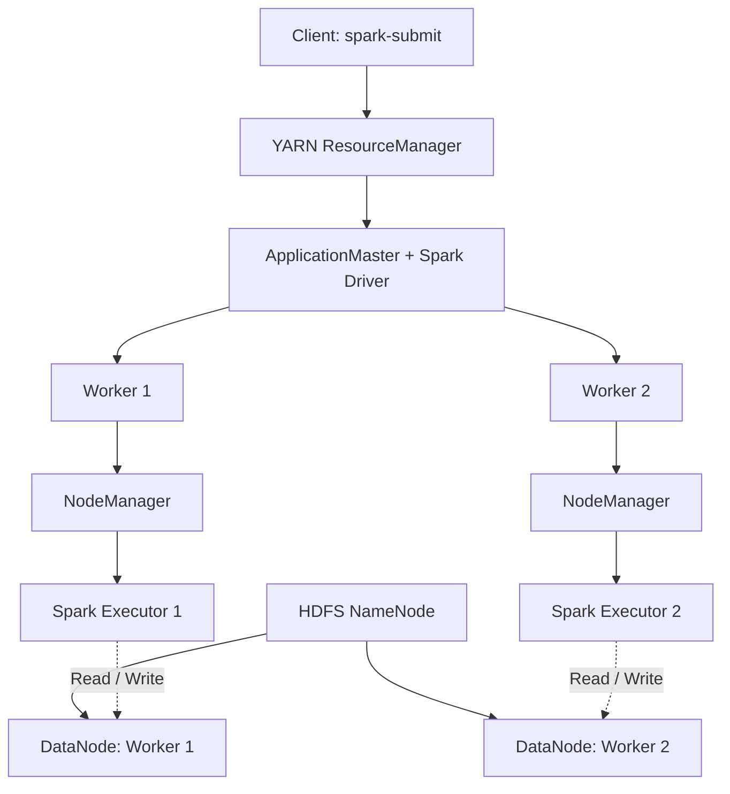

# Distributed Data Processing with Hadoop, YARN and Apache Spark

A hands-on distributed orchestration lab using Docker Compose, Hadoop HDFS, YARN and Apache Spark.

This project demonstrates how distributed storage, cluster resource management and distributed computation work together to process data across multiple worker nodes.

The environment consists of one master node and two worker nodes, with HDFS providing distributed storage, YARN managing cluster resources, and Apache Spark executing distributed data processing workloads.

## Architecture

The lab uses three Docker containers:

| Node | Services | Responsibility |
|---|---|---|
| Master | NameNode, ResourceManager | HDFS metadata management and cluster-wide resource coordination |
| Worker 1 | DataNode, NodeManager | Distributed storage and local resource management |
| Worker 2 | DataNode, NodeManager | Distributed storage and local resource management |

### Architecture diagram



**Important architectural distinction:**

- Docker Compose provisions and connects the infrastructure.
- HDFS manages distributed storage.
- YARN allocates resources and manages application containers.
- Spark Driver coordinates Spark execution.
- Spark Executors execute tasks on data partitions.

YARN does not schedule individual Spark tasks. That responsibility belongs to the Spark Driver.

## Technologies used

| Technology | Version / Purpose |
|---|---|
| Docker | Containerization |
| Docker Compose | Multi-container orchestration |
| Java | 11 |
| Hadoop | 3.3.6 |
| HDFS | Distributed storage |
| YARN | Cluster resource management |
| Apache Spark | 3.5.3 |
| Python | PySpark application development |

## Project structure

```text
yarn-spark-lab/
│
├── config/
│   ├── core-site.xml
│   ├── hdfs-site.xml
│   ├── yarn-site.xml
│   ├── mapred-site.xml
│   └── workers
│
├── data/
│   └── employees.csv
│
├── scripts/
│   └── department_salary.py
│
├── Dockerfile
├── docker-compose.yml
├── entrypoint.sh
└── README.md
```

## 1. Understanding the architecture

### HDFS – Distributed storage

HDFS (Hadoop Distributed File System) stores files across multiple machines.

It consists of:

- **NameNode:** Maintains filesystem metadata and block locations.
- **DataNodes:** Store the actual data blocks.
- **Replication:** Maintains multiple copies of data blocks for fault tolerance.

The lab uses a replication factor of 2.

### YARN – Resource management

YARN (Yet Another Resource Negotiator) manages resources across the cluster.

Its main components are:

- **ResourceManager:** Coordinates cluster-wide resource allocation.
- **NodeManager:** Manages resources and application containers on individual worker nodes.
- **ApplicationMaster:** Manages an individual application's interaction with YARN.

### Apache Spark – Distributed computation

Spark performs distributed data processing.

Its main components are:

- **Driver:** Coordinates the Spark application and schedules tasks.
- **Executors:** Execute tasks and process partitions.
- **Jobs:** Triggered by Spark actions.
- **Stages:** Groups of tasks separated by execution dependencies, particularly shuffle boundaries.
- **Tasks:** Individual units of work that process partitions.

In YARN cluster mode, the Spark Driver runs inside the ApplicationMaster container.

## 2. Configuration

The Hadoop configuration files are located in the `config/` directory.

| File | Purpose |
|---|---|
| `core-site.xml` | Defines the default HDFS filesystem |
| `hdfs-site.xml` | Configures HDFS storage and replication |
| `yarn-site.xml` | Configures YARN resource management |
| `mapred-site.xml` | Configures the MapReduce execution framework |
| `workers` | Lists the worker hostnames |

The environment uses:

- HDFS endpoint: `hdfs://master:8020`
- HDFS replication factor: `2`
- Two worker nodes
- Two YARN NodeManagers
- Configured NodeManager memory: 1536 MB
- Configured NodeManager CPU: 2 vcores

## 3. Build and start the cluster

### Prerequisites

- Docker Desktop
- Docker Compose v2
- Sufficient system memory and CPU resources

### Build the Docker image

```bash
docker compose build
```

### Start the cluster

```bash
docker compose up -d
```

### Check running containers

```bash
docker compose ps
```

### Inspect logs

```bash
docker compose logs -f
```

## 4. Access the web interfaces

Once the cluster is running, the following interfaces are available:

| Interface | URL |
|---|---|
| HDFS NameNode | http://localhost:9870 |
| YARN ResourceManager | http://localhost:8088 |
| Worker 1 NodeManager | http://localhost:8042 |
| Worker 2 NodeManager | http://localhost:8043 |

These interfaces help monitor HDFS storage, active YARN nodes, resource utilization, application execution and containers.

## 5. Upload data to HDFS

The example uses an employee dataset.

```csv
id,department,salary
1,Engineering,90000
2,Engineering,85000
3,HR,60000
4,HR,65000
5,Finance,75000
6,Finance,80000
7,Engineering,95000
8,Finance,70000
```

Create the HDFS directory:

```bash
docker compose exec master hdfs dfs -mkdir -p /user/spark/input
```

Upload the CSV:

```bash
docker compose exec master hdfs dfs -put data/employees.csv /user/spark/input/
```

Verify:

```bash
docker compose exec master hdfs dfs -ls /user/spark/input
```

## 6. Run the Spark application on YARN

The PySpark application performs department-wise salary analysis.

It:

1. Reads the employee CSV directly from HDFS.
2. Redistributes the DataFrame into four partitions.
3. Groups records by department.
4. Calculates employee count and average salary.
5. Writes the results back to HDFS.

Submit the application:

```bash
docker compose exec master spark-submit \
  --master yarn \
  --deploy-mode cluster \
  --num-executors 2 \
  --executor-cores 1 \
  --executor-memory 512m \
  --driver-memory 512m \
  scripts/department_salary.py
```

The application requests two executors, each with one core.

## 7. Expected output

| Department | Employee count | Average salary |
|---|---:|---:|
| Engineering | 3 | 90000 |
| HR | 2 | 62500 |
| Finance | 3 | 75000 |

The results are written to:

```text
/user/spark/output/department_salary
```

Inspect the output:

```bash
docker compose exec master hdfs dfs -ls /user/spark/output/department_salary
```

Read the generated CSV files:

```bash
docker compose exec master hdfs dfs -cat /user/spark/output/department_salary/part-*
```

## 8. Understanding distributed execution

One of the key experiments involved using:

```python
df = df.repartition(4)
```

This redistributes the DataFrame into four partitions and introduces a shuffle.

The Spark application requested:

```text
--num-executors 2
--executor-cores 1
```

The execution logs confirmed that YARN launched two executors:

- Executor 1 on worker1.
- Executor 2 on worker2.

The experiment also showed an important aspect of distributed execution:

**Four partitions do not guarantee that tasks will be distributed evenly across two worker nodes.**

In one observed stage, all four tasks ran on worker1. Other stages executed tasks on worker2.

This demonstrates that partitioning determines the logical units of work, whereas task placement depends on scheduling, available resources and data locality.

## 9. Monitoring YARN applications

List applications:

```bash
docker compose exec master yarn application -list
```

List active nodes:

```bash
docker compose exec master yarn node -list
```

Retrieve application logs:

```bash
docker compose exec master yarn logs -applicationId <APPLICATION_ID>
```

The ResourceManager interface provides application status and resource information.

The NodeManager interfaces provide information about individual worker nodes and their containers.

## 10. What this project demonstrates

Through this lab, the following concepts were explored hands-on:

- Multi-node infrastructure using Docker Compose.
- HDFS distributed storage and replication.
- NameNode and DataNode responsibilities.
- YARN resource allocation and application containers.
- ResourceManager and NodeManager responsibilities.
- Spark Driver and Executor architecture.
- Spark jobs, stages, tasks and partitions.
- Shuffle operations and repartitioning.
- Submitting Spark applications in YARN cluster mode.
- Monitoring distributed execution through web interfaces and logs.
- Understanding the difference between infrastructure orchestration, resource management and distributed computation.

## 11. Limitations and production considerations

This project is a learning environment, not a production-ready Hadoop deployment.

Some production considerations include:

- High availability for NameNode and ResourceManager.
- Authentication and authorization.
- Secure communication between services.
- Monitoring and alerting.
- Resource tuning and capacity planning.
- Data recovery and disaster recovery.
- Spark event logging and Spark History Server.
- Separating critical Hadoop services across dedicated infrastructure.

The master container combines NameNode and ResourceManager for simplicity.

## 12. Future enhancements

Potential extensions to this lab include:

- Integrating Apache Airflow for workflow orchestration.
- Adding Kafka for event-driven data ingestion.
- Implementing streaming workloads using Spark Structured Streaming.
- Adding a Spark History Server.
- Deploying the architecture on Kubernetes.
- Exploring fault tolerance by stopping and restarting worker nodes.

## Author

Built as a hands-on learning project to understand distributed systems, data engineering infrastructure, resource management and distributed computation.

**If you find this project useful, feel free to explore, fork and experiment with it.**
